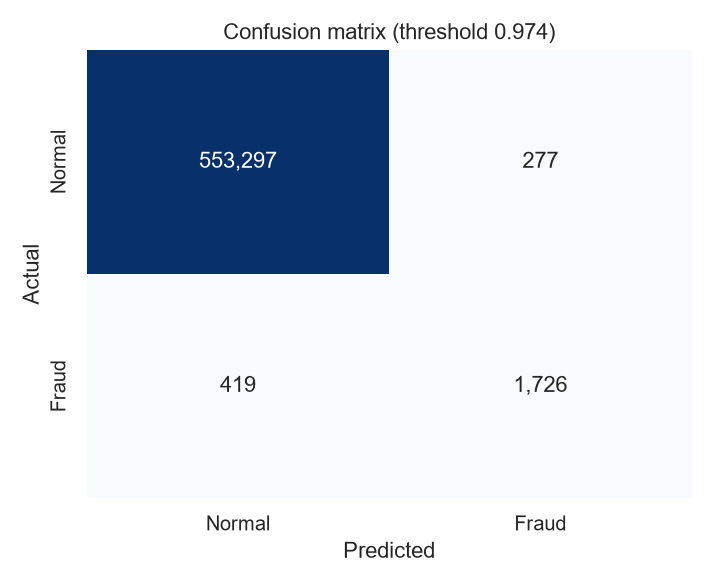
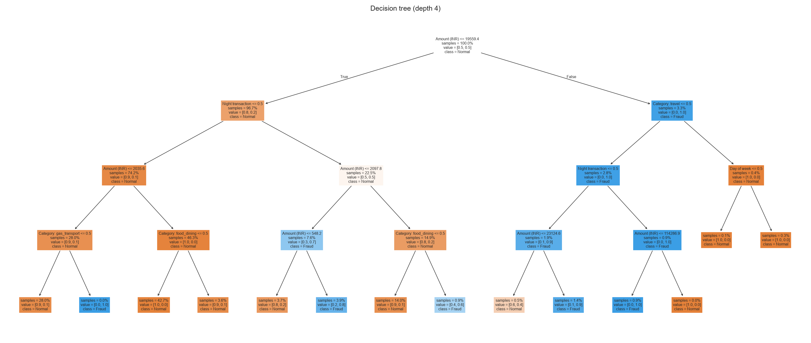
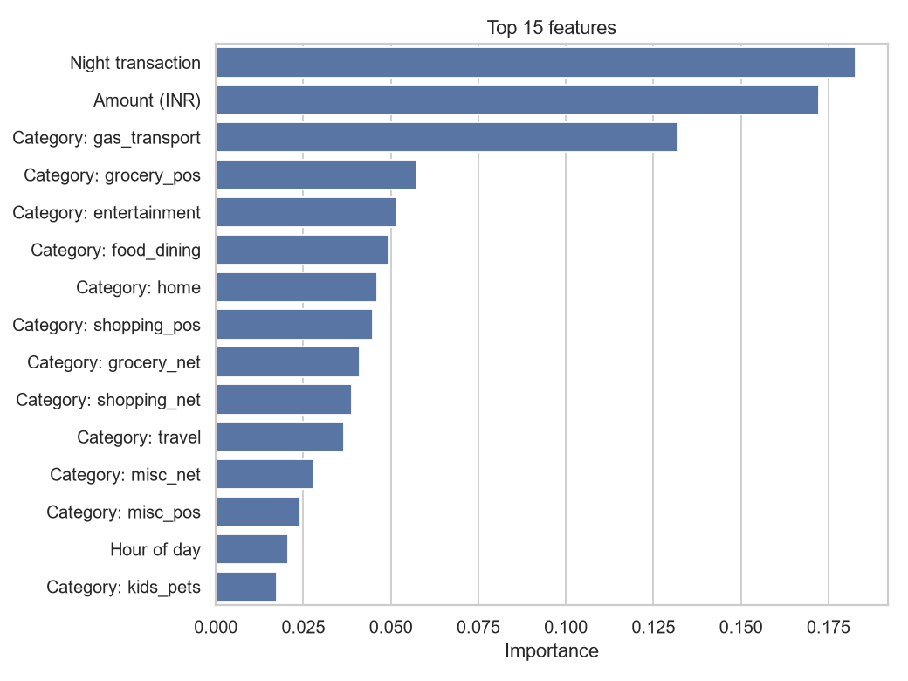
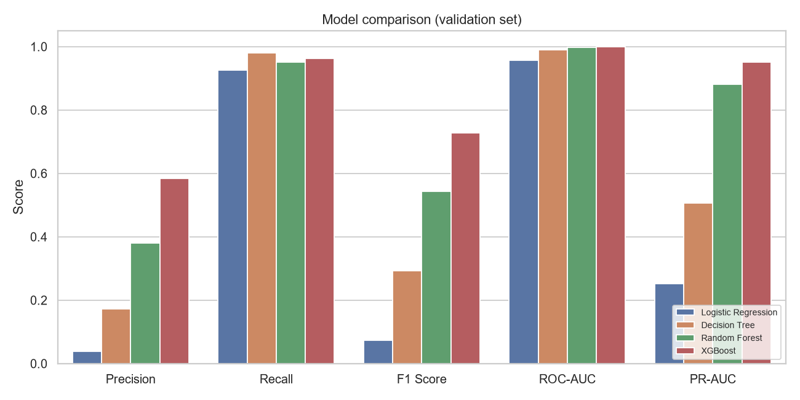
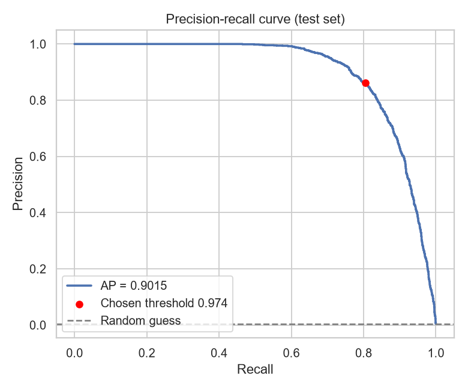
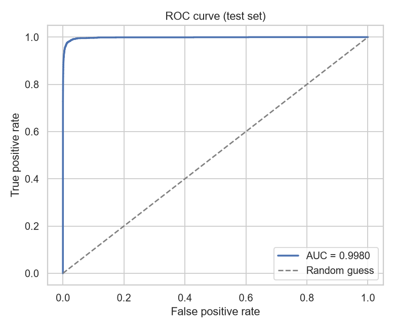
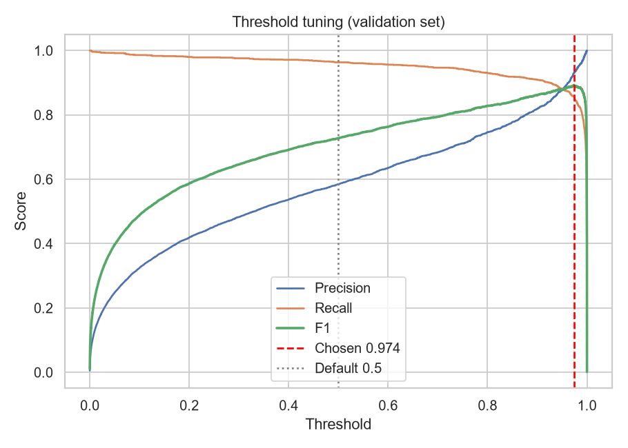

# Model Report

- Model: **XGBoost** (v1.0.0)
- Trained on: 2026-10-26T22:07:04
- Training rows: 1,296,675 · Test rows: 555,719
- Fraud rate: 0.58%
- Decision threshold: 0.974

## Test set

| Metric | Tuned (0.974) | Default (0.5) | Train (tuned) |
| --- | --- | --- | --- |
| Accuracy | 0.9987 | 0.9956 | 0.9992 |
| Precision | 0.8617 | 0.4644 | 0.9381 |
| Recall | 0.8047 | 0.9343 | 0.9265 |
| F1 Score | 0.8322 | 0.6204 | 0.9322 |
| Specificity | 0.9995 | 0.9958 | 0.9996 |
| ROC-AUC | 0.9980 | 0.9980 | 0.9999 |
| PR-AUC | 0.9015 | 0.9015 | 0.9870 |

## Confusion matrix (test set, tuned threshold)

| | Predicted normal | Predicted fraud |
| --- | --- | --- |
| Actual normal | 553,297 (TN) | 277 (FP) |
| Actual fraud | 419 (FN) | 1,726 (TP) |

## 5-fold cross validation

| Metric | Mean | Std |
| --- | --- | --- |
| Accuracy | 0.9987 | 0.0000 |
| Precision | 0.9212 | 0.0030 |
| Recall | 0.8500 | 0.0102 |
| F1 Score | 0.8841 | 0.0050 |
| Specificity | 0.9996 | 0.0000 |
| ROC-AUC | 0.9990 | 0.0003 |
| PR-AUC | 0.9458 | 0.0021 |

## Model comparison (validation set, threshold 0.5)

| Model | Accuracy | Precision | Recall | F1 Score | ROC-AUC | PR-AUC | Train time |
| --- | --- | --- | --- | --- | --- | --- | --- |
| Logistic Regression | 0.8649 | 0.0382 | 0.9254 | 0.0734 | 0.9563 | 0.2515 | 4.0s |
| Decision Tree | 0.9727 | 0.1725 | 0.9800 | 0.2934 | 0.9892 | 0.5056 | 15.5s |
| Random Forest | 0.9908 | 0.3805 | 0.9500 | 0.5433 | 0.9971 | 0.8808 | 80.3s |
| XGBoost ⭐ | 0.9958 | 0.5847 | 0.9634 | 0.7277 | 0.9992 | 0.9502 | 24.5s |

## Graphs

